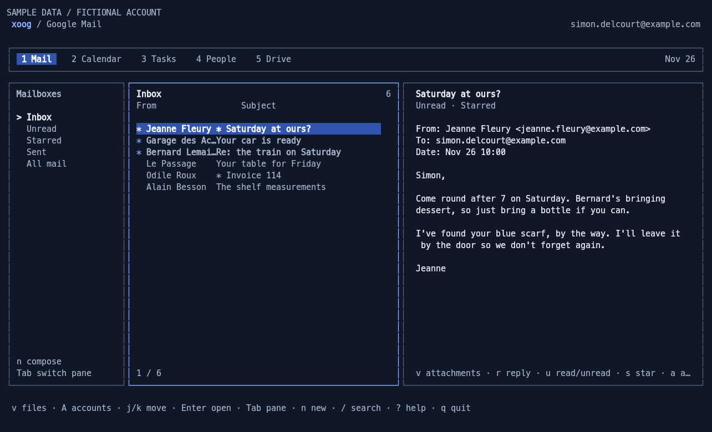

# 

Mail, calendar, tasks, contacts, and files in a React terminal app. Xoog runs
[Joog](https://github.com/joosuite/joog) for Google and
[Joom](https://github.com/joosuite/joom) for Microsoft as subprocesses and reads their JSON
output. Releases can include both backends, or you can use your installed binaries.

Xoog is an independent open-source project and is not affiliated with, endorsed
by, or sponsored by Google or Microsoft. It is provided "as is" under the
[Apache License, Version 2.0](LICENSE).



The screenshots use a fictitious Google account and synthetic content.
See [accounts, calendar, tasks, People, Drive, and terminal screenshots](docs/screenshots.md).

## Install and run

| Distribution | Separate Node.js installation | Joog and Joom |
| --- | --- | --- |
| GitHub binary, Xoog only | Not needed | Install the backend you use |
| GitHub binary, `with-backends` | Not needed | Both included |
| npm package, planned | Node.js 22 or newer | Install the backend you use |

### Binary downloads

Download a [binary release](https://github.com/joosuite/xoog/releases/latest) for
your computer. Both editions are available for these platforms:

| Platform | Architecture | Filename ending |
| --- | --- | --- |
| macOS | Apple Silicon | `darwin-arm64.tar.gz` |
| macOS | Intel | `darwin-x64.tar.gz` |
| Linux with glibc | x64 | `linux-x64.tar.gz` |
| Linux with glibc | ARM64 | `linux-arm64.tar.gz` |
| Windows | x64 | `win32-x64.zip` |

Choose an archive with `with-backends` in its name to include Joog and Joom.
Extract the entire archive, then run `./xoog` on macOS or Linux, or
`.\xoog.exe` on Windows. Keep the included backend binaries beside Xoog.
See [installation and checksums](docs/releases.md).

### npm

A standalone `xoog` package is planned for npm. Once published, install and run
it with Node.js 22 or newer:

```sh
npm install --global xoog
xoog
```

The npm package contains Xoog only. Install [Joog](https://github.com/joosuite/joog)
for Google or [Joom](https://github.com/joosuite/joom) for Microsoft separately
and put the backend on `PATH`.

### Run from source

Use Node.js 22 or newer and install the backend you use. From this directory:

```sh
npm ci
npm run build
npm start
```

To make the command available from a source checkout after building:

```sh
npm link
xoog
```

Use `npm start -- <options>` to pass options when running from the checkout.

## Accounts and settings

The [sign-in guide](docs/authentication.md) covers OAuth setup, enrollment,
login, account switching, and logout.

To choose an executable or the initial provider:

```sh
xoog --joog /path/to/joog
xoog --backend joom --joom /path/to/joom
```

Xoog checks each explicit binary option, then `JOOG_BIN` or `JOOM_BIN`, then
`PATH`, its bundled binary, and finally its optional sibling development binary. `--joom PATH`
selects Microsoft initially unless `--backend` chooses another provider.
The backends own sign-in, token refresh, and encrypted credentials. Xoog imports
neither backend's source code.

Press `1` for Google or `2` for Microsoft on the account screen. Xoog gets the
selected provider's accounts from its binary's `--json auth list` and opens the
account screen, including when saved accounts exist.
The first screen keeps Authentication on the left and all saved accounts with
Account actions on the right. In narrow terminals, the authentication shortcuts
sit above the account list. All actions stay visible without a setup submenu.

Choose an account and press `Enter` to open its workspace. `L` opens login,
and `X` logs out the selected account after confirmation. `I` runs `auth init`,
`E` opens `auth enroll`, and `T` runs `auth test`. Shortcuts accept either case.
`Tab` and `Shift+Tab` switch between Authentication, the account list, and
Account actions. Move with `j/k` or arrow keys, then press `Enter` to select.

For Google enrollment, enter the client ID and secret for a **Desktop app**.
The secret is masked and passed to Joog over stdin. Login opens your browser
to authorize mail, calendar, tasks, contacts, and Drive. `Esc` cancels an in-progress operation.
Press `g` to refresh the saved accounts after a cancellation or external change.

For Microsoft enrollment, enter only the Application client ID for a mobile
and desktop app registration in Microsoft Entra. Register
`http://localhost/oauth/callback`. Joom uses PKCE and requests no client secret.
Login opens Microsoft authorization for Outlook, Calendar, To Do, Contacts, and
OneDrive. The account email does not determine which provider to use.

Press `A` in the workspace to return to account management and switch accounts
or providers. The same email can have independent accounts in both backends.
`--home PATH` uses custom backend state directories for account management
and workspace requests. `--calendar ID` and `--tasklist ID` choose the initial collections.
Use `--theme light` for a light background. The default theme is dark. Both
themes set their background and text colors explicitly.

Xoog reuses the selected backend's encrypted response cache for five minutes by default.
Use `xoog --ttl 10` to set another lifetime in minutes, or `xoog --ttl 0` to
disable caching. This applies to Mail, Calendar, Tasks, People, and Drive reads.
Press `f` to force a refresh even before the TTL expires. `g` reloads using the
configured TTL. Forced reads bypass that cache for that refresh; subsequent
reads use the configured TTL again. Writes and file downloads bypass
the response cache; the backend invalidates cached responses when data changes through
its write commands.

## Use the workspace

At 110 columns or wider, Xoog shows collection navigation, a list, and a preview.
At 82–109 columns, it shows the list and preview. Smaller terminals switch
between the list and reader. The minimum size is 52 columns by 18 rows.

Overflowing lists, readers, help, account lists, and draft reviews show a vertical
scrollbar. Its thumb shows the visible portion and moves as you navigate with
the keyboard. The scrollbar disappears when all content fits.

| Key | Action |
| --- | --- |
| `1`, `2`, `3`, `4`, `5` | Mail, calendar, tasks, People, Drive |
| `A` | Return to account management |
| `Tab`, `Shift+Tab` | Change pane |
| `h`, `l`, left, right | Focus the previous or next pane |
| `j`, `k`, up, down | Move or scroll |
| `Enter` | Choose a collection or open an item |
| `/` | Search the current collection |
| `v` | Show the selected message's attachments |
| `Esc` | Return to the list or clear a search |
| `n` | Compose mail, create an event, or create a task |
| `g` | Refresh |
| `f` | Force refresh, bypassing the cache |
| `?` | Show shortcuts |
| `q`, `Ctrl+C` | Quit |

In People, choose Contacts, Starred, or Other contacts. Search with `/` across
names, email addresses, phone numbers, and contact details. The reader shows
addresses, organizations, birthdays, websites, and notes when available.

In Drive, choose My Drive, Recent, Starred, or Shared with me. Press `Enter` to
open a folder and `Backspace` to go up. `/` searches file contents and names
within the current collection or folder. Xoog loads up to 200 files per listing.
Press `d` on a file to choose where to save it. Existing files are kept, and
`Esc` cancels. Google Docs, Slides, and Drawings download as PDF. Sheets download
as Excel `.xlsx` files. Folders and unsupported Google file types cannot be
downloaded. People supports contact browsing and search. Drive supports file browsing,
search, and downloads.

If an existing account lacks Contacts or Drive permissions, return to Accounts
with `A`, press `L`, and log in again to grant them. You can keep the existing
OAuth client enrollment. Enable the People API and Drive API in that client's
Google Cloud project if Google reports either API as disabled.

For Microsoft, all five tabs use Joom. Contacts has one collection, and Drive
browses and searches OneDrive folders. Office files download in their original
formats. Xoog omits Google's Starred/Other contacts, Recent/Starred/Shared drive
collections, and Outlook archive because Joom does not expose those operations.
The mail star action maps to an Outlook flag. Use All mail for full-text searches;
Joom rejects combinations of full-text search and read/flag filters. Replies send
MIME reply headers without forcing an Outlook conversation ID.

In Google mail, `u` toggles read status, `s` toggles the star, `a` archives, and `r`
replies. Opening a message with `Enter` marks it as read. Merely selecting a
message for preview leaves its read status unchanged. Search supports Gmail
query syntax.

Press `v` on a message to see attachment names, MIME types, and sizes. Move with
`j/k`, then press `Enter` for a preview. UTF-8 text previews stay in the terminal
and scroll with `j/k` or Page Up/Down. Press `o` to open a PDF or supported image
in the system viewer. Other file types can be downloaded.

Press `d` in the attachment screen to choose a destination path, then `Enter` to
save. The default is the current directory. `~/` expands to your home directory.
Existing files are kept. `Esc` cancels an operation or returns to the attachment
list, then to mail. Preview files are temporary and are removed when you leave
the attachment screen. Text previews show up to 256 KiB; downloads save the full file.

In calendar, press `d` to choose a date. Use Left/Right to move one day,
Up/Down to move one week, and Page Up/Down to change month. You can also type
an exact date as `YYYY-MM-DD`. Press `Enter` to apply it or `Esc` to cancel.
The agenda starts on the chosen date, and `t` returns to today. The `[` and `]`
shortcuts also move the agenda by a whole week.
The agenda covers seven days in the terminal's local timezone. Timed event
creation requires RFC 3339 timestamps with a timezone, such as
`2026-11-25T09:00:00+01:00`. All-day events appear in the reader.

In tasks, `Space` completes or reopens the selected task. Task due dates use
`YYYY-MM-DD`. Search matches task titles and notes locally.

To change a mailbox, calendar, or task list, focus navigation with `h` or `Tab`,
move with `j` or `k`, then press `Enter`. Navigation also opens at narrow widths.

## Create an item

Press `n`, fill the fields, and use `Tab` to move between them. In a message
body, `Enter` adds a line. `Ctrl+S` opens a review screen. After reviewing the
fields, press `Enter` to send or create the item. `Esc` returns to editing.
Pressing `Esc` while editing discards the draft.

Xoog currently loads at most 40 messages, 200 events, or 200 tasks per collection.
It lists up to 100 calendars and task lists. Event editing, task
editing, and persistent drafts are outside this initial version.

## Troubleshoot

Press `g` to retry a failed request. If Joog is missing, install it or pass
`--joog`. For authentication errors, press `A` and use login or authentication
setup. Use `--no-alt-screen` if your terminal does not
support an alternate screen. Xoog restores the normal screen when it exits.

If login fails to unlock the OS Keychain master key, the failure happens before
the browser opens. This does not mean the saved Google client needs enrolling
again. Use the Joog executable that has keychain access, unlock the keychain,
and retry. Xoog shows the complete error in a scrollable panel. The browser
waiting message appears only after Joog confirms that it opened the browser.

## Develop

```sh
npm run dev
npm run check
npm test
npm run build
```

The tests run against synthetic data and a fixture executable. They do not
contact Google. See [the architecture](docs/architecture.md) for the subprocess
contract and state handling.

## Documentation

- [Sign-in setup and account management](docs/authentication.md)
- [Screenshots with a fictitious Google account](docs/screenshots.md)
- [Local tests and manual verification](docs/testing.md)
- [Architecture and Joog binary contract](docs/architecture.md)
- [Brand assets](assets/brand/README.md)

## Contribute

Read [CONTRIBUTING.md](CONTRIBUTING.md) for development checks and pull requests,
and the [code of conduct](CODE_OF_CONDUCT.md) for participation guidelines.
Use the repository's bug or feature request template when opening an issue.
Include terminal dimensions and screenshots with private content removed.
For vulnerabilities, follow [SECURITY.md](SECURITY.md).

## License

Xoog is licensed under the [Apache License, Version 2.0](LICENSE).
Third-party dependencies retain their respective licenses.
