# Xoog screenshots

These are captures of the working terminal app, with the fictitious Google
account Simon Delcourt at `simon.delcourt@example.com`. All people, messages, events,
tasks, contacts, and files are synthetic. A **SAMPLE DATA / FICTIONAL ACCOUNT** banner identifies
the screenshot fixtures.
The capture fixture fixes the date to November 26, 2026.

## Account management

Authentication actions sit on the left. Saved accounts and Account actions sit
on the right. The approved cell wordmark appears when there is room.

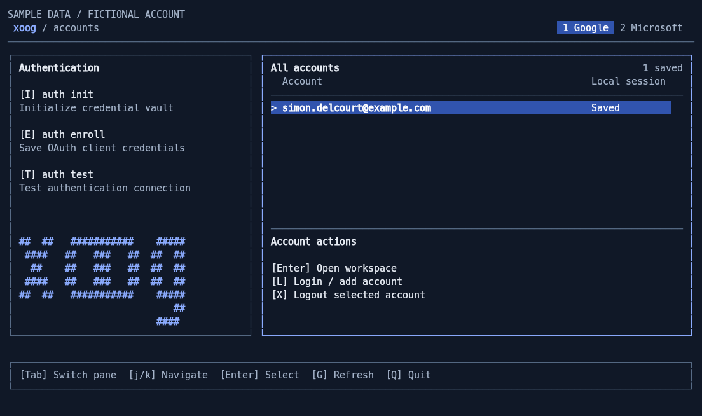

## Mail

The split workspace keeps mailboxes, the message list, and the selected message
visible together. The account shown is fictitious.

## Attachments

Press `v` in mail to list the selected message's files. These captures show
Odile's fictional invoice and hours sheet.

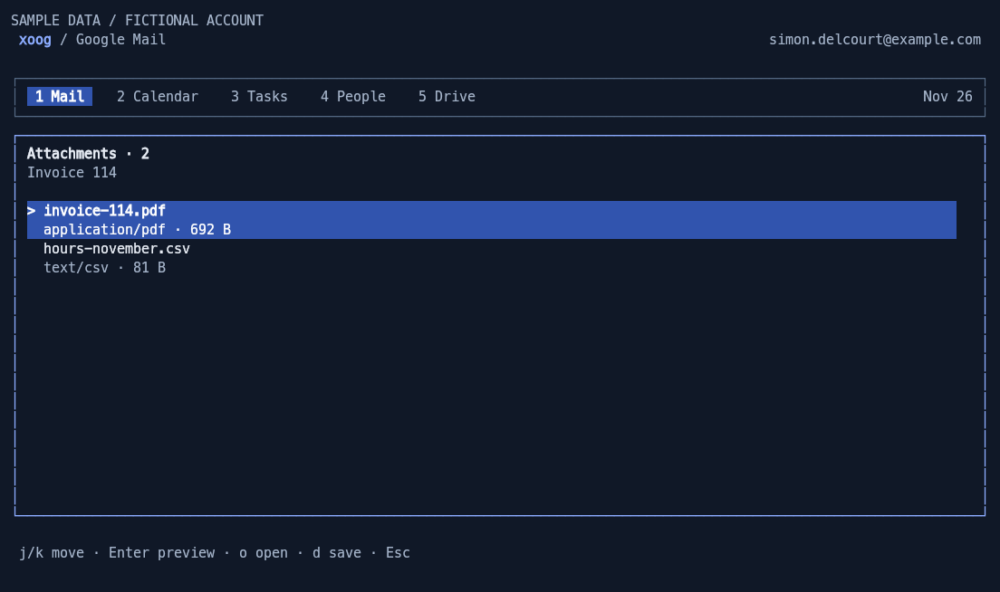

UTF-8 text stays in a scrollable terminal preview. PDFs and supported images
open in the system viewer only when you press `o`.

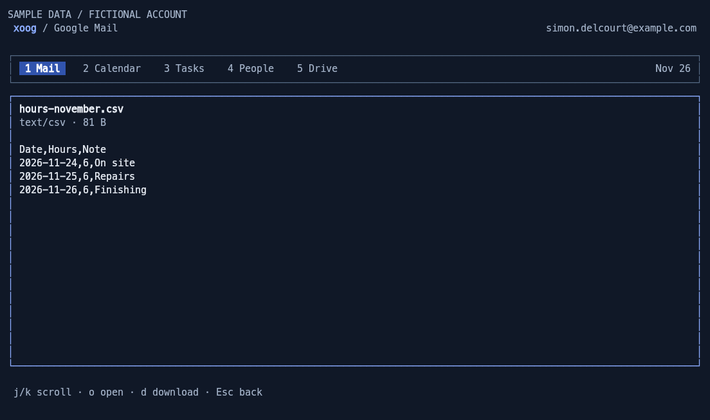

Press `d` to choose a download path. Existing files are kept.

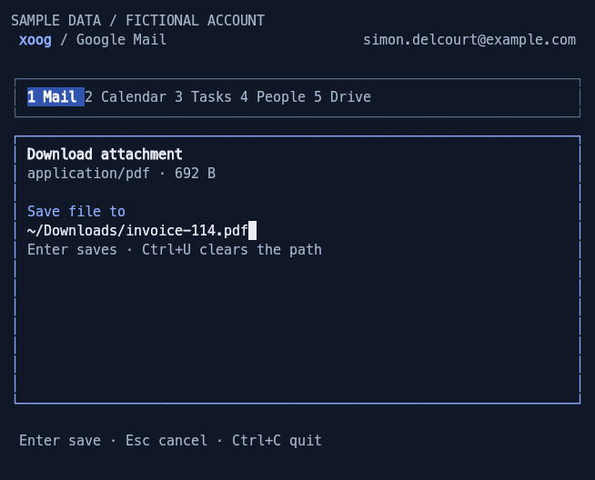

## Calendar

The agenda lists events for seven days, with the selected event's time, location,
attendees, and notes in the reader.
Press `d` to choose an individual date with the calendar picker or type
`YYYY-MM-DD`, then press `Enter` to show its agenda.

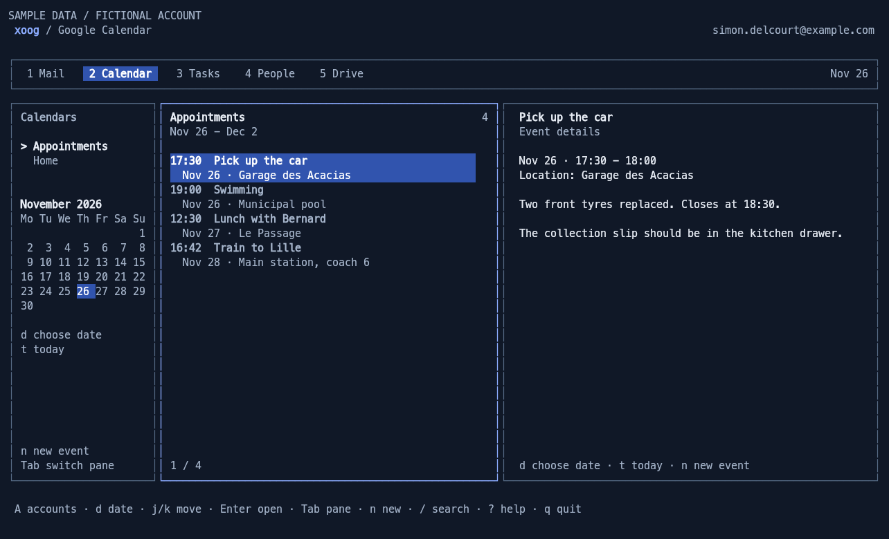

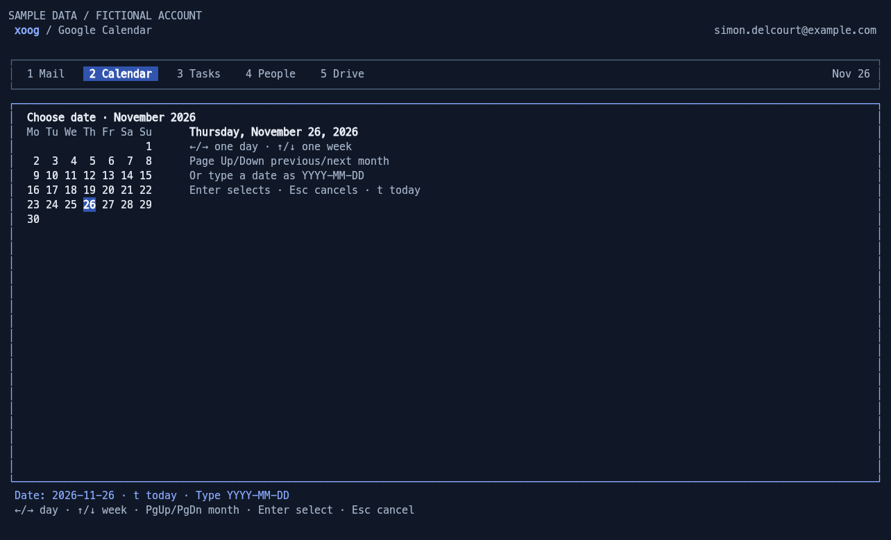

## Tasks

Task lists, completion state, due dates, and the selected task's notes share the
same keyboard-driven workspace.

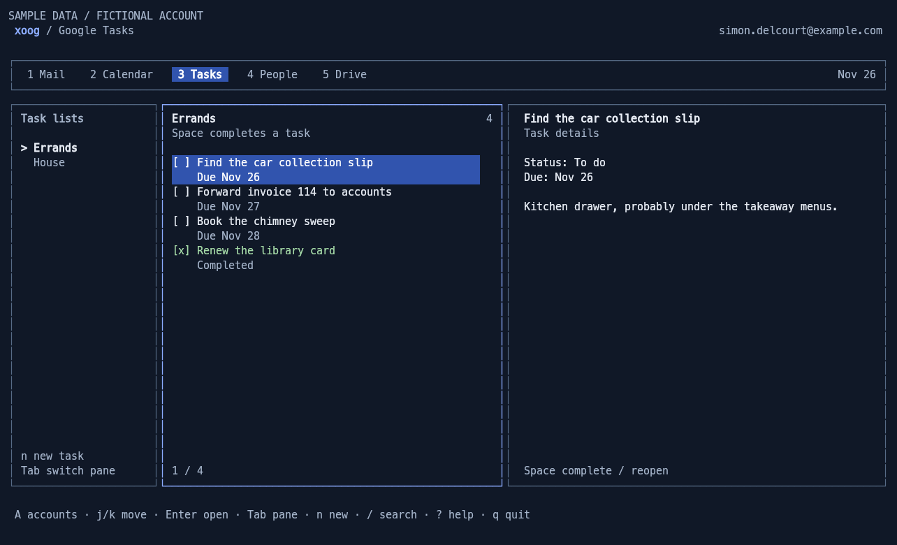

## People

The People tab lists contacts and shows their email addresses, phone numbers,
addresses, and notes in the reader.

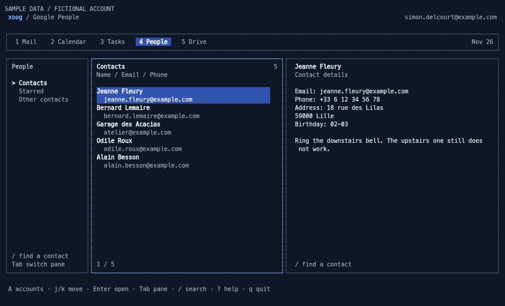

## Drive

The Drive tab shows folders and files with the selected file's details. Press
`Enter` to enter a folder, `Backspace` to go up, and `d` to download a file.

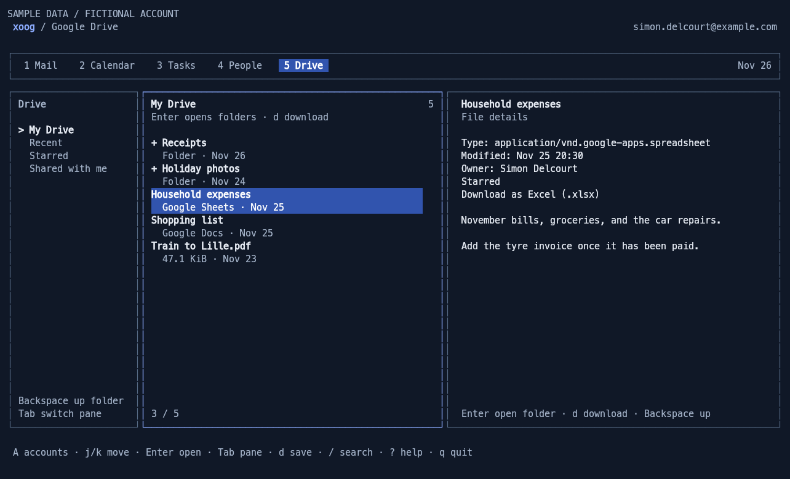

## Light theme

Use `--theme light` to switch the app's background and text colors.

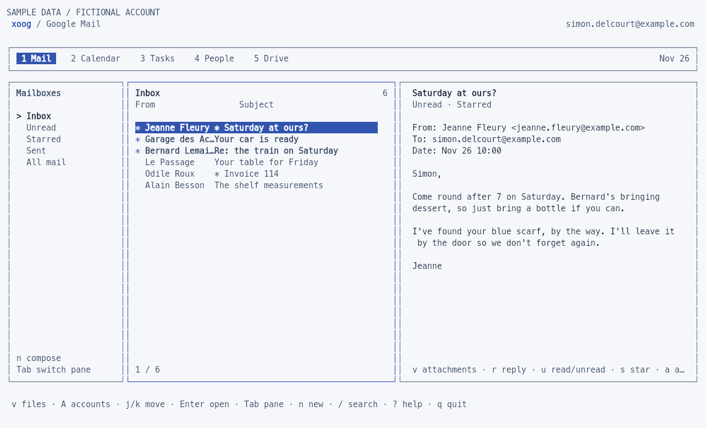

## Narrow terminal

Smaller terminals show the list and reader one at a time. Press `Enter` to read
an item and `Esc` to return to the list.

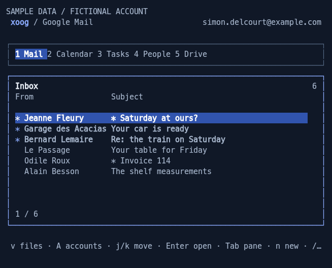

The [capture guide](../assets/screenshots/README.md) documents dimensions, fixtures,
and the command to regenerate the images. These captures are real terminal
renders, not image mockups.

## Microsoft through Joom

The account header switches between Google and Microsoft. Microsoft uses the
same workspace for Outlook, Calendar, To Do, Contacts, and OneDrive.
These captures use the same fictitious account, with synthetic Microsoft content.

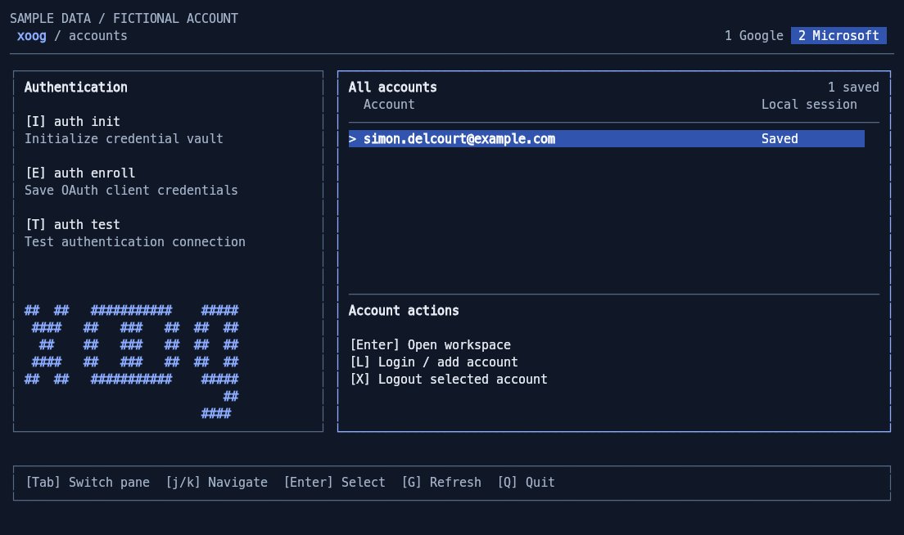

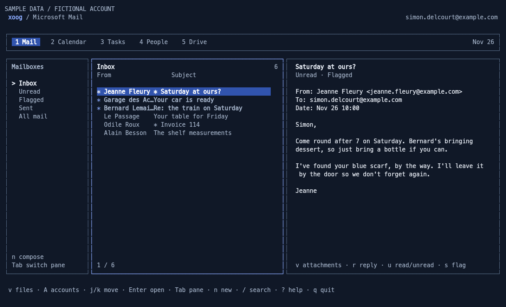

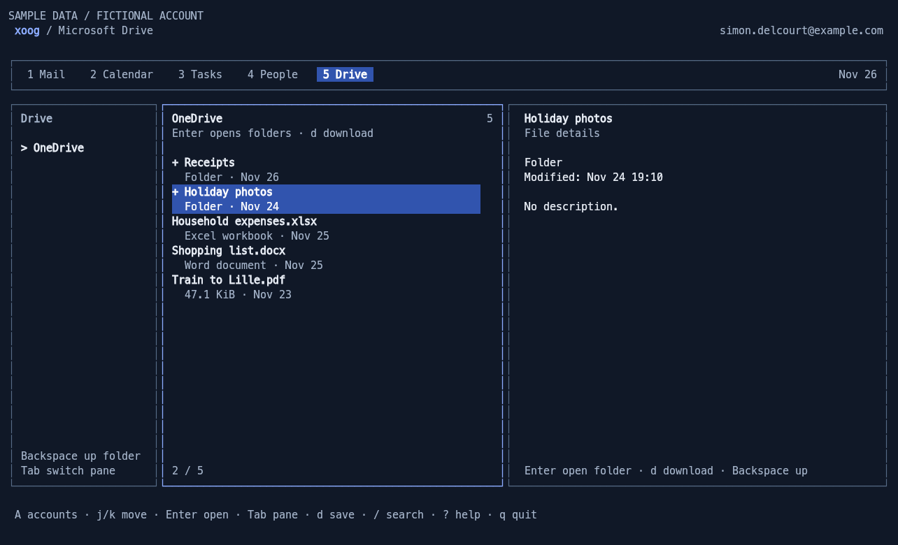
